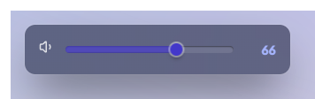
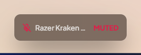
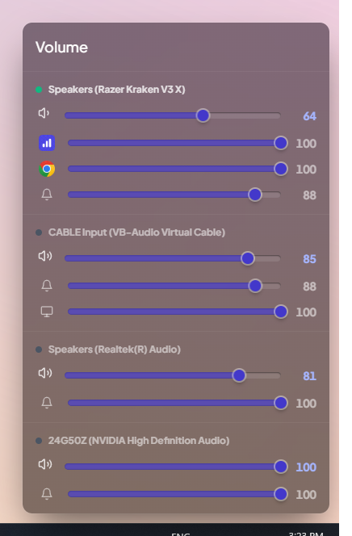
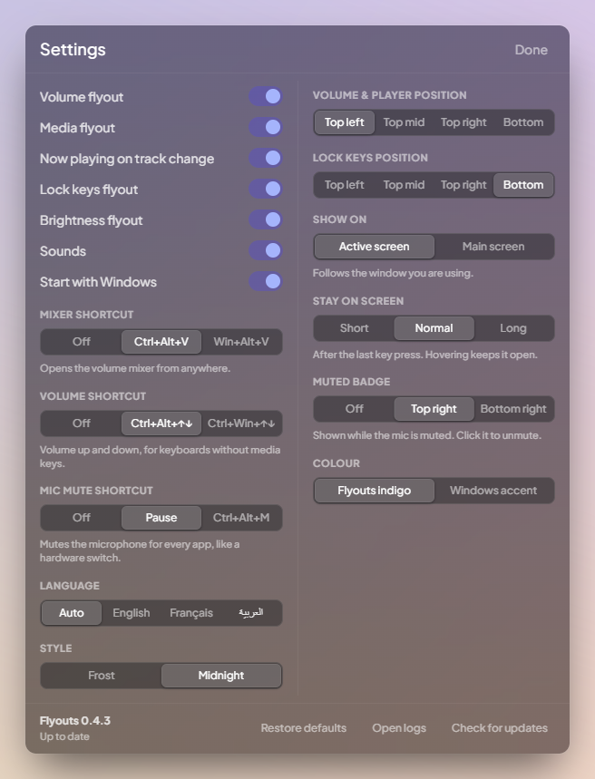
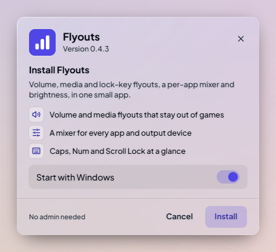

  

<h1 align="center">Flyouts</h1>

  Volume, media and lock-key flyouts, a per-app volume mixer and a mic mute key for Windows. 
  One small app that replaces Windows' own flyouts and stays out of your games.

  <a href="https://github.com/mainyaszed/Flyouts/releases/latest"><b>Download FlyoutsSetup.exe</b></a>
  &nbsp;·&nbsp; Windows 10 and 11 (64-bit) &nbsp;·&nbsp; English, Français, العربية

  
  

## What it does

- **Volume flyout** for the volume keys, with a live level and a soft tick sound (optional).
- **Media flyout** with the cover, title, controls and a progress bar you can click, and a "now playing" card when the track changes.
- **Video previews**: for YouTube in your browser, the cover fades into real frames from the video, flipping like a GIF.
- **Volume mixer** for every app on every output device. Right-click an app to send it to a different output.
- **Mic mute**: press **Pause** (or a shortcut you record in Settings) to mute your microphone in every app at once. A small "Muted" badge stays on screen until you unmute; click it to unmute.
- **Bluetooth headset battery** next to the volume, for headsets that report it.
- **Caps, Num and Scroll Lock** flyouts, and **brightness** for laptops and DDC/CI monitors.
- **Stays out of games**: nothing pops up over a fullscreen game, and it never takes focus.
- **Light**: about 60 MB of memory at idle and practically no CPU.

  
  

## Install

1. Download **FlyoutsSetup.exe** from the [latest release](https://github.com/mainyaszed/Flyouts/releases/latest).
2. Run it and click **Install**. It installs for your account only, no admin needed.

Windows may show "Windows protected your PC" because the app isn't code-signed yet: click **More info**, then **Run anyway**.

Flyouts lives in the tray, next to the clock. Click it for the mixer, right-click it for settings. Updates download and install themselves; every update is checked against the publisher's signature before it's installed.

  

## Shortcuts

| Shortcut | What it does |
|---|---|
| Volume keys | Volume flyout |
| Ctrl+Alt+↑ / ↓ | Volume up and down (for keyboards without media keys) |
| Ctrl+Alt+V | Open the volume mixer |
| Pause | Mute or unmute the microphone |

All of them can be changed or turned off in Settings.

## Privacy

Flyouts collects nothing. It doesn't use analytics or telemetry and has no account. It goes online to ask GitHub whether there's a new version, and, while Video previews is on, to look up what's playing in your browser on YouTube and download its preview frames (turn it off in Settings to stop that). If it ever crashes, it offers to open a pre-filled GitHub issue; nothing is sent unless you submit it yourself.

## Uninstall

Settings > Apps > Installed apps > Flyouts > Uninstall. Your settings are kept in `%APPDATA%\Flyouts` in case you come back; delete that folder to remove them too.

## Problems and ideas

[Open an issue](https://github.com/mainyaszed/Flyouts/issues). Settings > Open logs shows the log files, which help with bugs.

## License

Free to use; see [LICENSE](LICENSE).
